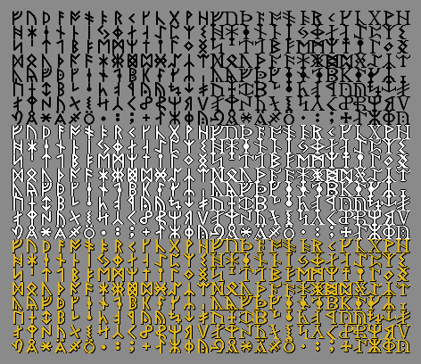
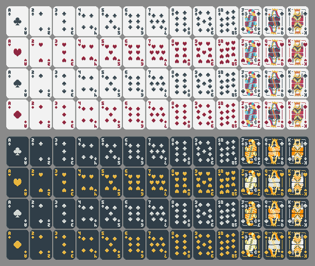

# 🃏 Luvierre — Propuesta

> Propuesta individual de un juego web indie minimalista en JavaScript: un **blackjack roguelite** con tienda, jokers, tarot y runas, inspirado en el loop de *Balatro*.

**Autor:** Sadrach34
**Estado:** 📝 etapa de planeación (propuesta). Aún sin juego publicado.
**Juego en línea (GitHub Pages):** _pendiente_
**Video explicativo del código:** _pendiente_

---

## 1. Concepto

Es un blackjack común (**Pedir**, **Plantarse** y **Doblar**; sin split ni seguro) donde cada nivel pide una **meta de fichas** que debes alcanzar en un número limitado de manos. Apuestas fichas en cada mano; si superas la meta pasas a la **tienda**, donde compras y vendes cartas y mejoras para hacer tu mazo cada vez más fuerte.

El reto no es solo ganar manos, sino **construir una combinación** de jokers, cartas y runas que multiplique tus ganancias.

## 2. Loop de juego

1. **Dealer** (antes “nivel”) = una meta de fichas total + **7 manos** (un reparto = una mano; pedir carta no cuenta).
2. Cada mano: apuestas → se reparten cartas → Pedir / Plantarse / Doblar → se calcula el resultado.
3. **Vences al dealer** al **llegar a la meta y tener 2 manos ganadas**. Entonces cobras y vas a la **tienda**, o sigues jugando tus manos restantes para juntar más fichas (las fichas se arrastran siempre). _Supuesto a confirmar: el simulador antiguo usaba “2 de 3 rondas”._
4. Si te quedas sin fichas (menos de la apuesta mínima) o sin manos sin vencer al dealer, **game over** y se guarda tu récord.
5. Cada **etapa** tiene **3 dealers**; el tercero es el **jefe** y tiene un efecto malo fijo.
6. **Metas estilo Balatro:** en cada mesa, Pip = base ×1, Mordaz = base ×1.5 y el jefe = base ×2. La base de la mesa 1 es **170** (170 / 255 / 340) y cada mesa nueva multiplica la base por **×2.6** (mesa 2: 440 / 665 / 885, mesa 3: 1 150 / 1 725 / 2 300…), redondeado a múltiplos de 5.
7. **Empiezas con 150 fichas.** No empiezas con jokers: los jokers son **premios** que consigues en la tienda por haber ganado niveles.

## 3. Reglas base

- Mazo propio del jugador (52 cartas al inicio); se rebaraja al agotarse.
- El dealer planta en 16 (configurable). Bust = pierdes la apuesta.
- Blackjack natural paga 3:2. Empate devuelve la apuesta.
- **Mover cartas:** puedes reordenar tu mano **arrastrando las cartas** durante tu turno (también los **jokers**, en la mesa y en la tienda); la primera carta y el orden determinan cuál se activa primero con los jokers y habilidades.
- **Doblar:** duplicas tu apuesta, recibes **una carta más** y te plantas. Solo se puede en tu **primera decisión** (con 2 cartas) y si tienes fichas para cubrir la apuesta doble. Los jokers y el multi se aplican igual; el pago sale de la apuesta ya doblada. _Pendiente: confirmar si también se permite con más de 2 cartas._
- **Descartes:** **3 descartes por dealer**, compartidos entre las 3 rondas de ese dealer (se reinician al empezar con el siguiente dealer, jefe incluido). Descartar = quitas una carta de tu mano y robas otra en su lugar. **No cuenta como mano** (igual que pedir carta). Puedes usar los **3 en la misma mano** si quieres (mientras queden y antes de doblar o plantarte); la carta descartada sale hasta rebarajar. Sirve para escapar de una mano rígida o armar un combo. La mesa debe mostrar los **descartes que te quedan**. Las runas, tarots o vales pueden dar descartes extra (ampliación). _Pendiente: confirmar si se puede descartar tras pedir carta._

## 4. Sistema de puntuación (fichas y multi)

Cada mano da un total **T** (suma de blackjack). Los jokers y las cartas con efecto se aplican **en orden** (jokers de izquierda a derecha, cartas según el orden de la mano):

- **Efecto de fichas:** suma a un pool `F`. **No** cambia el total de la mano; solo se suma al pago final si ganas.
- **Efecto multi:** multiplica `M` (empieza en ×1).
- **El orden importa:** un multi al inicio rinde poco; fichas primero y multi al final rinde mucho. Por eso los jokers se compran y luego se **acomodan**.
- **Policromo** (edición): aplica un efecto extra justo **después** del efecto de su carta o joker (ej. joker ×1.5 → policromo ×1.5 → siguiente joker).

### Combos de mano (base, sin jokers)

Al plantarte, tu **mano final** se revisa como una mano de póker. Si tiene un combo, da **fichas (F)** y **multi (M)** base. Es el “puntos base” del juego: se aplica **primero**, antes de jokers y cartas con efecto, y luego el resto de efectos suma o multiplica encima. Solo cuenta **un combo** por mano: el de mayor prioridad (el primero de la tabla). Si te pasas de 21 no hay combo.

| Combo | Qué es | F | M |
|---|---|---|---|
| Triple siete | 3 o más sietes | +50 | ×2.0 |
| Cinco cartas | 5 o más cartas sin pasarte | +40 | ×1.5 |
| Escalera | 3+ cartas seguidas, todas distintas (el As vale bajo o alto) | +25 | ×1.5 |
| Color | 3+ cartas y todas del mismo palo | +20 | ×1.3 |
| Tercia | 3 cartas del mismo rango | +30 | ×1.5 |
| Doble par | dos pares | +20 | ×1.4 |
| Par | 2 cartas del mismo rango | +10 | ×1.2 |
| 21 | suma 21 con 3 o más cartas (el 21 natural ya paga 3:2) | +10 | ×1.2 |

- Valores **iniciales**, para ajustar con el simulador (`src/data/combos.js`). Se pueden apagar con `combos: false` en `config.js`.
- El multi del combo funciona igual que cualquier multi: puede dar una **victoria por multi** (ver *Resolución*).
- Frecuencia aproximada (jugador pidiendo hasta 16, sin jokers): par 9.6 %, 21 de 3+ cartas 4.7 %, color 1.6 %, escalera 1.0 %, cinco cartas 1.0 %, tercia y doble par 0.1 %, triple siete ~0 %. El resto (82 %, incluyendo pasarse) no da combo.
- **Subir de nivel un combo** con tarots o vales (como los planetas de Balatro) y **combos de jokers** (par, color, etc., §5) quedan como ampliación; los tarots que cambian palos o rangos ya ayudan a armarlos.
- _Pendiente: decidir qué combos entran en la versión 1 y ajustar valores._

**Efecto de los descartes (simulador, con combos y doblar, 150 fichas, metas 205 / 260 / 330, 10 000 partidas):** el bot *perseguidor + doblar* pasa de 71 / 53 / 39 % (sin descartes) a **74 / 60 / 47 %** con 3 descartes por dealer, 77 / 64 / 51 % con 5 y 78 / 65 / 53 % con 8. La estrategia de descarte importa: un bot que tira la carta baja para buscar combos **empeora** (64 / 46 / 31 %), y uno que tira la carta alta con mano rígida (12-16) mejora. Por eso 3 por dealer es un buen punto de partida: ayuda sin dominar.

**Efecto en el balance (simulador, 150 fichas, metas 205 / 260 / 330, 3 rondas por dealer, 10 000 partidas):**

| Bot | Sin combos | Con combos |
|---|---|---|
| medio | 48 / 30 / 19 % | 58 / 42 / 30 % |
| perseguidor de meta | 56 / 34 / 21 % | 69 / 51 / 36 % |
| estrategia básica | 47 / 29 / 17 % | 55 / 39 / 26 % |
| perseguidor + doblar | 58 / 38 / 24 % | 71 / 53 / 39 % |

Cada celda es el porcentaje acumulado que vence a Pip / Mordaz / El Muro.

### Resolución de la mano

1. Si `T > 21` → bust, pierdes. El multi no sirve.
2. Se calcula `T × M`. Si pasa de 21, el multi **no se aplica**. Si es 21 o menos, **sí se aplica**.
3. Se compara con el dealer (D):
   - `T > D` → **victoria normal**: pago = `(apuesta + F) × M`.
   - `T ≤ D` pero `T × M > D` → **victoria por multi**: ganas, pero **pagas menos** (50 % del pago base). Si `T × M = 21` con 2 cartas cuenta como blackjack, también con pago reducido.
   - `T × M ≤ D` → pierdes y el multi no sirve de nada.

**Ejemplos**

| Tú | Dealer | Multi | Resultado |
|---|---|---|---|
| 7 | 9 | ×1.5 → 10.5 → **10** (se redondea hacia abajo) | Ganas por multi (pago reducido) |
| 4 | 9 | ×1.5 → 6 | Pierdes, el multi no se aplica |
| 14 (2 cartas) | 16 | ×1.5 → 21 | Blackjack por multi (pago reducido) |

### Redondeo
Los puntos para ganar **nunca son .5**: todo se **redondea hacia abajo** (a la cantidad menor). Esto aplica al total con multi (ej. 10.5 → 10) y a los pagos.

### Monedas (dinero de la tienda)
Las **fichas** son la apuesta y la meta. La **tienda** usa **monedas ($) aparte**, para que comprar no te deje sin banca.

Al **terminar cada nivel** recibes monedas según cómo jugaste:

| Concepto | Monedas (valores iniciales, ajustables) |
|---|---|
| Superar el nivel | $3 base |
| Manos sin usar | +$1 por cada mano que te sobre |
| Fichas ganadas | +$1 por cada 50 fichas por encima de la meta (tope: **$10**) |
| Interés | ver abajo |
| Jefe derrotado | +$3 extra |

### Interés
Si guardas dinero sin gastar, **gana intereses**: al terminar cada nivel recibes **$1 por cada $5** que tengas guardados. **Máximo $5 por nivel.** Ejemplo: en el nivel 1 no tienes nada; ganas $5 pero todo está muy caro y no compras; al terminar el siguiente nivel ya cobras $1 de interés por esos $5.

El tope sube a **$10 por nivel** si compras el vale de interés (ver *Vales*).

## 5. Jokers

- Máximo **5 slots** (ampliable). Son pasivos y se **reordenan**: el orden es el orden de aplicación.
- Hay jokers de **fichas** y de **multi** por separado para cada combinación:
  - **Par**, **doble par**, **tercia**, **color** (mano de un solo palo): uno da fichas y otro da multi.
  - **Monocromo:** cualquier palo, ×1.5.
  - **Por palo:** uno para ♥, ♦, ♠ y ♣, ×1.75 cada uno (incentiva podar los otros palos).
  - **Minimalista:** ganar con menos de 3 cartas → multi grande (ej. ×20).
  - **Doble primera:** la primera carta cuenta dos veces.
  - **Eco:** reactiva la habilidad de las cartas compradas (es un joker distinto al anterior).
  - **Discípulo del tarot:** +×0.1 por cada tarot usado en la partida.
- **Ediciones** (más raras):
  - **Policromo:** efecto extra después del propio.
  - **Negativo:** funciona normal pero da **+1 slot** (no cuenta para el límite). También se puede poner en **consumibles** (da +1 slot de consumible).
- Las cartas del mazo también pueden tener efectos (ej. +1/+2/+3 fichas, carta multi) y edición Policromo.
- **Límites de efectos:** una **carta** puede tener como máximo **2** (un efecto + Policromo). Un **joker** solo puede tener **una edición** (Policromo **o** Negativo). Con Negativo el tope es 5+1 = 6, y puedes acumular tantos jokers Negativo como consigas.

## 6. Tienda

- Máximo **4 espacios**: 1 carta de mazo + 3 jokers.
- **2 paquetes siempre disponibles**:
  - Paquete de **jokers** (elegir 1; en algunos, 2).
  - Paquete de **tarot**: muestra **4 tarots y eliges 1**. Al comprarlo **tienes que usar el tarot ahí mismo**, no se guarda. **Mega paquete:** 6 tarots, eliges 2.
  - Paquete de **runas** (muy raro): muestra **2 runas pero solo eliges 1**, y **debes usarla en ese momento** (queda activa el resto de la partida). **Mega paquete:** 4 runas, eliges 2.
  - Lo más común es elegir una sola carta.
- Los **mega paquetes** aparecen **con menos probabilidad** que los paquetes normales.
- Entre los 3 slots de jokers, **con baja probabilidad** uno puede ser reemplazado por una **carta de tarot**, y con probabilidad **muy muy baja** por una **runa**.
- **Reroll** siempre disponible, cuesta monedas y **el precio crece** con cada uso.
- **Vales:** mejoras permanentes que se compran en la tienda (ver *Vales*).
- **Vender cartas:** máximo **1 por visita**. El precio depende del palo: cada venta de un palo baja su valor (por ejemplo 3 → 2 → 1 → 0, y ya no ganas nada); cada visita en que **no** vendes ese palo, sube **muy poco a poco**. Esto incentiva especializarse en un palo.

## 6.1 Interfaz y mecánicas de pantalla

**Mesa**
- El **mazo** se ve como un mazo real: cartas apiladas, con animación al robar una carta.
- La **primera carta del dealer siempre está boca abajo** y la segunda boca arriba. Se muestra como `??? + 2` si la visible es un 2.
- El fondo tiene **animación** (se desplaza hacia una esquina). _Pendiente de confirmar si esta animación es del fondo o de los jokers._
- Los **jokers tienen diálogos** que aparecen entre manos durante la partida.
- El **vale** se coloca en la **esquina contraria** a la posición actual.
- Debe haber un lugar para **ingresar una semilla** (botón o pantalla; por decidir).

**Mazo**
- Al hacer clic en el mazo se ve **todo el mazo**; las cartas **ya usadas** en la mano actual se ven **en gris**. Esta vista también está disponible en la **tienda**.
- Cada carta con efecto se muestra **individualmente** (no agrupada): puedes tener 4 K♠ y que cada una tenga un efecto distinto.
- **Sin distintivo en la carta:** se quita la idea de un sello/etiqueta visible. Al **pasar el mouse** sobre una carta sale un **cuadro** con lo que hace y, **debajo del cuadro principal**, un cuadro por cada efecto que tiene (ej. *Suerte*, *Policromo*).
- En **partida** el mazo muestra las cartas **ya usadas** en gris oscuro y **más pequeñas**; fuera de partida (menú/tienda) todas se ven normales. Es una **vista propia** del mazo, con las cartas **divididas por palo**.
- Una carta puede tener **un solo efecto** y además **Policromo**. Ejemplo: *Suerte + Policromo*, solo *Policromo* o solo *Suerte*. El efecto *Suerte* aún no está definido.

**Distribución de la mesa (propuesta)**
- **Arriba, centrados en horizontal:** los **jokers**.
- **A la derecha:** los **2 espacios de consumibles** y, **debajo** de ellos, las **runas** activas.
- **A la izquierda** (donde antes estaban los jokers): la **imagen del dealer** y la **meta** de fichas que hay que alcanzar (hay que vencer al dealer 3 veces).
- _Con estos cambios el diseño de varias ventanas puede cambiar._

**Tienda: espacio y venta de jokers**
- Hay un botón **Vender** para jokers. Para comprar un joker (o abrir un paquete que dé un joker) necesitas **espacio libre**; si no hay, aparece **“sin espacio”**.
- Opciones entonces: **vender un joker** para hacer espacio, o **saltarte el paquete**.
- Los paquetes de **tarot y runas** también pueden mostrar esta situación, porque un tarot o runa puede **afectar a un joker** (ej. darle Policromo o Negativo).

**Consumibles**
- Siempre hay **2 espacios de consumibles** visibles. Un tarot comprado tiene dos opciones: **comprar y usar ahora** o **comprar y guardarlo** para usarlo después (por ejemplo si su efecto no aplica todavía, como *La Estrella*, que necesita cartas visibles).

**Selección de dealer**
- **Saltarte un dealer** te da una **recompensa** (ejemplo: +20 monedas). No es el vale de interés; es otro tipo de premio por saltar.
- Cada dealer se debe vencer **3 veces**, excepto el jefe, que quizá sean **4**. _Pendiente: no está definido si esto reemplaza la meta de fichas o se combina con ella._

**Paquetes de tarot y runas**
- Al abrir un paquete de tarot se muestran **7 a 10 cartas de tu mazo** (por decidir) para elegir sobre cuál aplicar el efecto, y **debajo** las opciones de tarot o runa del paquete.
- Opciones por paquete: tarot 4 (elige 1), mega tarot 6 (elige 2), runas 2 (elige 1), mega runas 4 (elige 2).

## 6.2 Diseño base de la interfaz (17 pantallas)

Diseño de referencia hecho en un canvas de Claude (artifact: https://claude.ai/artifact/CmEtSPCzCRZLYRLTWvVAB8). **Título en el diseño: _El Casino de Luvierre_.** Estética: pixel art, fuente *Pixelify Sans*, negro/dorado con acentos rojo vino, guirnalda dorada arriba, fondo en damero que se desplaza, viñeta oscura. Mazo claro u oscuro y reverso elegibles. Es un diseño **base**: puede cambiar.

| # | Pantalla | Qué muestra |
|---|---|---|
| 1 | Menú principal | Título, Luvierre (bufón) con globo de diálogo, botones **Modo diario** (semilla del día), **Modo infinito**, **Semilla**, **Récords**, engranaje de configuración (Esc) |
| 2 | Semilla | Diaria / Aleatoria / Mía (escribir o pegar), copiar, semillas recientes con puntaje, Volver / Empezar partida |
| 3 | Selección de dealer | 3 tarjetas por mesa (Pip, Mordaz, El Muro): meta, recompensa en monedas, rondas a ganar, **Jugar** y **Saltar dealer** (vale: +20 / +30 monedas). El jefe **no se puede saltar**. Cabecera: semilla, **Ver mazo**, monedas |
| 4 | Mesa (partida) | Ver abajo |
| 5 | Resultado del dealer | Dealer derrotado + desglose de monedas (recompensa, manos sobrantes, fichas extra, interés), total y monedas antes → después, **Ir a la tienda** |
| 6 | Tienda | Jokers, consumibles, 3 artículos (carta, joker, tarot), vale, paquetes, **Reroll**, diálogo de Luvierre, **Mazo (ver y vender cartas)**, **Siguiente dealer**. Sin espacio: “toca uno de los tuyos para venderlo” |
| 7 | Paquete de jokers | Elige 1 de 3 |
| 8 / 9 | Paquete / Mega paquete de tarot | Elige 1 de 4 / 2 de 6; **cartas de tu mazo** para marcar (hasta 2) y debajo los tarots; algunos tarots eligen un **joker** de la barra superior (ej. *El Prisma*: Policromo) |
| 10 / 11 | Paquete / Mega paquete de runas | Elige 1 de 2 / 2 de 4 |
| 12 | Configuración (Esc) | Diseño de cartas (Clásico claro / Nocturno oscuro), reverso (verde, rojo, gris, azul, negro), música, efectos, velocidad (Normal / Rápida / Turbo), diálogos de dealers, animación de cartas, pantalla completa, **Abandonar partida**, Agradecimientos, Reanudar |
| 13 | Estadísticas (modal) | Mejor mano, manos, victorias/derrotas, blackjacks, pasadas, racha, monedas, rerolls, mazo, tarots, runas, jokers vendidos, carta más jugada, joker más valioso |
| 14 | Próximos dealers (modal) | Solo ver. La mesa siguiente se muestra con **???** hasta vencer al jefe |
| 15 | Agradecimientos | **Una tarjeta por colaborador** de los packs usados: avatar con su inicial, nombre, aporte, texto “¡Síguelo en itch.io!” y botón **VER SU PÁGINA ↗** a la página de origen; al final la tarjeta destacada de **Sadrach34 — Creador y desarrollador** con enlace a github.com/Sadrach34, y “…y a ti, por sentarte a jugar” |
| 16 | Tu mazo completo (modal) | Cartas por palo; en partida las ya salidas se ven **en gris y pequeñas** |
| 17 | Fin del paquete | Tras usar un tarot, las cartas mostradas **regresan al mazo** (con su efecto nuevo) |

**Mesa (4):** arriba **jokers** (5/5, con orden, edición Policromo/Negativo visibles) y **consumibles** (2); a un lado runas, dealer, diálogo del dealer, **meta**, **tus fichas** y “te faltan X”, victorias de la mesa (ej. 1 de 2 necesarias), monedas. Centro: cartas del dealer (`???+2`) y las tuyas; panel **Fichas × Mult = resultado** (“se resuelve al plantarte”) con el desglose por joker. Abajo: **apuesta** (− / + / Apostar), **Pedir**, **Plantarse**, **Doblar**, mazo (cartas restantes), botones **DEALERS**, **STATS**, **ESC**.

**Cambios que trae el diseño frente al resto del README (por decidir):**
- **Rondas por dealer:** hay que ganar **2 de 3 rondas** (jefe: **3 de 5**) en vez de “vencerlo 3 veces”.
- **Recompensa por dealer:** Pip $3, Mordaz $4, El Muro $5; saltar da $20 / $30 (el jefe no se salta).
- **El Muro en el diseño** dice “tu primera mano de la ronda no suma fichas”, pero el README dice “el dealer planta en 18”. **Pendiente: elegir uno.**
- **Cartas de ejemplo:** efecto *Suerte* aparece en el diseño (“Suerte + Policromo”) y se obtiene con el tarot *El Trébol*. Efectos de tarot de ejemplo (*El Prisma*, *El Espejo*, *El Trébol*, *La Torre*, *La Luna*) **no coinciden** con la tabla de §7: son placeholders.
- Hay un vale de ejemplo (*Vale de Rebaja*: rerolls cuestan $2 menos).
- Imágenes de tarot en el diseño son marcadores “IMAGEN”.

## 7. Tarot, runas y vales

### Reglas generales
- **Ningún efecto es temporal.** Los efectos del tarot son **permanentes para esa carta** (no para el resto de cartas). No existe "la siguiente ronda te da ×2 y luego desaparece".
- Los tarots y las runas **de un paquete se usan en el momento** en que abres el paquete. Un tarot **comprado suelto** en la tienda puede **usarse al instante o guardarse** en uno de los **2 espacios de consumibles** (ver *Consumibles* en 6.1). Las runas siempre se usan al elegirlas.
- Los tarots que modifican cartas te piden elegir **una carta de tu mazo**.
- **La Rueda de la Fortuna** es la excepción: se aplica a **jokers**, no a cartas.

### Tabla de cartas de tarot
Valores propuestos; se ajustan en la fase de balance.

| # | Tarot | Efecto (permanente en la carta elegida) |
|---|---|---|
| 0 | El Loco | Añade al mazo una **copia** de la carta elegida |
| 1 | El Mago | La carta da **+10 fichas** cada vez que se activa |
| 2 | La Sacerdotisa | Sube el **rango en +1** (el As y el K no suben) |
| 3 | La Emperatriz | La carta se vuelve **Multi ×1.5** |
| 4 | El Emperador | La carta da **+25 fichas** |
| 5 | El Hierofante | La carta cuenta como **cualquier palo** (comodín para Color/Monocromo) |
| 6 | Los Enamorados | La carta gana la edición **Policromo** |
| 7 | El Carro | La carta **se activa dos veces** (reactiva su efecto) |
| 8 | La Fuerza | Sube el **rango en +2** (máximo 10) |
| 9 | El Ermitaño | **Destruye** la carta elegida y ganas **$3** |
| 10 | La Rueda de la Fortuna | **Solo jokers:** 50 % nada; 50 % de efecto (ver tabla abajo) |
| 11 | La Justicia | El **valor** de la carta pasa a ser **10** de forma fija |
| 12 | El Colgado | **Destruye** hasta 2 cartas elegidas (adelgaza el mazo) |
| 13 | La Muerte | Elige 2 cartas: la **carta de la izquierda se convierte en copia de la carta de la derecha** (rango, palo y efectos) |
| 14 | La Templanza | Ganas **$2 por cada joker** que tengas (máx. $10) |
| 15 | El Diablo | La carta da **+40 fichas**, pero **ya no se puede vender** |
| 16 | La Torre | La carta cambia a un **rango aleatorio** y gana **+15 fichas** |
| 17 | La Estrella | Hasta 2 cartas cambian a **♦ diamantes** |
| 18 | La Luna | Hasta 2 cartas cambian a **♣ tréboles** |
| 19 | El Sol | Hasta 2 cartas cambian a **♥ corazones** |
| 20 | El Juicio | Añade al mazo una **carta aleatoria** con un efecto de carta aleatorio |
| 21 | El Mundo | Hasta 2 cartas cambian a **♠ picas** |

**La Rueda de la Fortuna** (solo jokers). Hoy solo existen dos ediciones, pero habrá más en el futuro, así que cada una tiene una probabilidad baja y la mitad "con efecto" se repartirá entre todas:

| Resultado | Probabilidad |
|---|---|
| Nada (el joker queda igual) | 50 % |
| Edición **Policromo** | 35 % |
| Edición **Negativo** | 15 % |

### Tabla de runas
Las runas duran **toda la partida hasta que pierdas**. A simple vista casi nunca parecen llamativas, pero bien combinadas pueden cambiar el rumbo del run. Del paquete de runas se elige **1 de 2**, y se usa al instante. Valores propuestos.

| Runa | Rareza | Efecto (toda la partida) |
|---|---|---|
| ᚠ Fehu | Común | Recibes **+$1** extra al terminar cada nivel |
| ᚢ Uruz | Común | Cada victoria normal suma **+5 fichas** al pago |
| ᚦ Thurisaz | Común | Si pierdes con **20 o 21**, recuperas el **25 %** de la apuesta |
| ᚨ Ansuz | Común | Puedes ver la **siguiente carta** del mazo antes de pedir |
| ᚲ Kenaz | Rara | El **primer joker** (el de más a la izquierda) se activa **dos veces** |
| ᚷ Gebo | Común | El precio de venta de un palo **baja a la mitad de velocidad** |
| ᚹ Wunjo | Rara | La **primera mano** de cada nivel nunca pierde más del **50 %** de la apuesta |
| ᚺ Hagalaz | Rara | Las victorias por multi pagan **65 %** en vez de 50 % |
| ᚾ Nauthiz | Común | El **primer reroll** de cada tienda es **gratis** |
| ᛃ Jera | Rara | El interés se cobra por cada **$4** guardados en vez de $5 |
| ᛇ Eihwaz | Rara | Una vez por nivel, la **última carta pedida** que te haría bust se descarta |
| ᛉ Algiz | Rara | **+1 slot** de joker |
| ᛊ Sowilo | Común | Tu multi **empieza en ×1.1** en vez de ×1 |
| ᛖ Ehwaz | Común | La **primera carta** de tu mano da **+10 fichas** |
| ᛜ Ingwaz | Rara | **Activa (al usarla):** elige 1 carta de tu mazo y se vuelve **Policromo** (×1.5 extra al activarse, permanente en esa carta). Se usa como un tarot: seleccionas la carta y aplicas la runa. |
| ᛞ Dagaz | Legendaria | **Una vez por partida**, si fallas la meta, **superas el nivel igual** (la runa se consume) |
| ᛟ Othala | Legendaria | **+1 slot** de joker y **+1 mano** por nivel |

### Vales
Mejoras permanentes que se compran en la tienda (hay un espacio de vale visible). Por ahora existe **uno solo**; en el futuro habrá más con efectos muy variados.

| Vale | Precio inicial | Efecto |
|---|---|---|
| Vale de interés | $10 | Sube el **límite de interés** de $5 a **$10** por nivel |

### Vale secreto: la Tienda de Mogo (clandestina)
Un vale **secreto con probabilidad muy baja** de aparecer. Al comprarlo, la **Tienda de Mogo queda abierta de forma permanente durante esa partida**: puedes entrar a ella en cada visita a la tienda hasta que termine el run.

- **Siempre** tiene como mínimo **1 joker** y **1 carta normal** (carta de mazo).
- El joker o la carta normal pueden **cambiar por otra cosa** (otro joker, otra carta, un tarot…).
- Con una **pequeña probabilidad** aparecen más artículos: cartas, tarots, runas, etc.
- Las **runas** de esta tienda se ven **de otro color** (se aprovechan las versiones de color del pack de runas).
- Se paga con **monedas**, como la tienda normal.
- _Pendiente por definir:_ precios, probabilidades exactas y lista de artículos.

### Cartas tainted / cursed (fuera de la versión 1)
Versiones de las cartas que ya existen pero con un **efecto malo** (algo positivo con un costo negativo). **No están definidas al 100 % y no saldrán en la v1.** Es probable que se vendan en la Tienda de Mogo. Efectos por definir.

## 8. Dealers, etapas y jefes

El juego se divide en **etapas** (ST). Cada etapa tiene **3 niveles**, y cada nivel es un **dealer** distinto con su meta de fichas. El tercero es el **dealer jefe**. Al vencer al jefe se pasa a la siguiente etapa.

```
ST1 N1 → ST1 N2 → ST1 N3 (jefe) → ST2 N1 → ST2 N2 → ST2 N3 (jefe) → …
```

**Etapa 1**

| Nivel | Dealer | Meta (propuesta) | Efecto |
|---|---|---|---|
| N1 | **Pip** | 170 | ninguno |
| N2 | **Mordaz** | 255 | ninguno |
| N3 | **El Muro** (jefe) | 340 | El dealer **planta en 18** |

### Personalidad y diálogos
Cada dealer tiene **nombre y personalidad propios**; los diálogos **cambian en el canvas** durante la partida y en la tienda (incitan a gastar o arriesgarse).

| Personaje | Personalidad | Qué te incita a hacer |
|---|---|---|
| **Pip** | Juguetón, todo lo toma a broma | Que **pidas cartas** |
| **Mordaz** | Sádico | **All-in**: “si ganas te doy el doble; si pierdes, ya veremos cómo cobro ese doble” |
| **El Muro** | Callado y pensativo | Que **cometas errores** |
| **Luvierre** (menú principal) | Anfitrión del desafío | Que juegues: si ganas, **mucho dinero**; si pierdes, pagas con **algo más que dinero** |

- Al ser **vencidos**, los dealers sueltan diálogos: esperan que pierdas, amenazan con que **el siguiente será más fuerte**, dicen que **el juego nunca termina y ellos siempre ganan**.
- **Luvierre** también tiene diálogos en el **menú**. El nombre del casino/título (ej. *Luvierre Gambit*) está **por decidir**.

Las etapas siguientes tendrán sus propios dealers (nombres por definir); la regla de los jefes es: **el nombre del jefe es su efecto, siempre el mismo**.

### Pool de efectos de jefe (para etapas siguientes)
Estos efectos se irán asignando a jefes con nombre propio. _El Muro ya es el jefe de la etapa 1._

| Jefe | Efecto (siempre) |
|---|---|
| El Corazón Roto | Las cartas ♥ **no suman puntos** |
| El Diamante Opaco | Las cartas ♦ **no suman puntos** |
| El Trébol Marchito | Las cartas ♣ **no suman puntos** |
| La Pica Rota | Las cartas ♠ **no suman puntos** |
| El Muro | El **dealer planta en 18** |
| El Ciego | Una carta de tu mano queda **boca abajo** |
| El Avaro | **Apuesta mínima ×2** |
| El Mudo | No aparecen **paquetes de tarot** en la tienda siguiente |
| El Manco | **Una mano menos** en el nivel |
| El Eclipse | El **joker de más a la derecha** está desactivado |

## 9. Modos de juego

- **Diario:** semilla fija según la fecha; todos juegan la misma tienda, mazo y jefes y comparan puntaje. Un intento por día.
- **Infinito:** semilla aleatoria que se muestra al empezar (para poder repetirla); niveles sin fin con metas crecientes.

## 10. Apartado visual y audio

- Estilo **pixel art** minimalista.
- Cartas: mazo de póker en pixel art de 48×64 px (candidato: *Pixelated Deck* de Ventura, versión oscura en negro y dorado).
- **Dealer:** un bufón / arlequín (nombre por decidir: Ludovico o Pierrot) con el pack *Pixel Joker – Character Sprite Pack*.
- Los jokers del juego serán, por ahora, un **cuadro con su nombre** (placeholder) hasta tener arte.
- **Números:** los dígitos 0–9 usan la fuente **Silkscreen** (`@fontsource/silkscreen`, solo el rango U+0030-0039 vía `unicode-range`) porque el 5 de *Pixelify Sans* se confunde con un 8; las letras siguen en *Pixelify Sans*. Solo cambian los dígitos, el resto de la tipografía no. Además, los readouts numéricos van **sin negrita** (`font-weight:400`): meta, fichas, mazo, apuesta, totales del dealer/jugador, cálculo F×M, monedas y tiles de estadísticas/récords.
- **Audio:** efectos sencillos (repartir, ganar, perder, comprar, runa) y botón de silencio.

## 11. Tecnología propuesta

- **JavaScript (ES modules) + Vite**, sin framework: las pantallas son **DOM + CSS** portadas del diseño (pixel art con `image-rendering: pixelated`, fuente *Pixelify Sans*), animaciones con CSS y Web Animations API y el escenario fijo de 1280×720 que se escala a la ventana. _(Se descartó Phaser 3: el diseño es HTML/CSS y así queda idéntico.)_
- Lógica del juego separada de la interfaz, para poder probarla y simularla en Node.
- Generador aleatorio con **semilla**, con flujos separados (mazo / tienda / jefes).
- `localStorage` para récord, intento diario y ajustes.
- Publicación en **GitHub Pages** con GitHub Actions.

### Guardar y cargar partidas

- **Autoguardado:** la partida se guarda sola en cada pantalla donde se puede reanudar (selección de dealer, mesa entre manos, resultado, tienda y paquetes) y al terminar cada mano. Al perder, se borra. El menú muestra **Continuar** con mesa, dealer y fichas.
- **Guardado manual:** Configuración → **Guardar partida** (una ranura). El menú la ofrece como **Cargar**. Si guardas a mitad de una mano, se vuelve al inicio de esa mano (las fichas se pagan al resolverla, no se pierde nada).
- **Qué se guarda:** todo el estado de la partida y los generadores aleatorios, así que continúa idéntica (mismas tiendas y cartas). Al cargar se usa la configuración de balance actual.
- **En desarrollo** (`npm run dev`): al recargar la página por un cambio de código se retoma la partida donde estaba. Usa `?fresh` en la URL para empezar en el menú.
- Se guarda en `localStorage` (`luvierre.save.auto` / `luvierre.save.manual`), formato versionado en `src/core/save.js`.

### Idiomas (español / inglés)

Todos los textos del juego viven en **`src/i18n/es.json` y `src/i18n/en.json`** (JSON plano con claves como `table.hit` o `joker.par_f.name`; las listas de diálogos son arreglos). El idioma se elige en **Configuración** y se guarda en `localStorage`; la primera vez se toma del navegador. Cambiarlo redibuja la pantalla al instante (en la mesa, al terminar la mano en curso). Para agregar un idioma: copiar `es.json`, traducirlo y registrarlo en `src/i18n/index.js` (`LANGS`). Las pruebas (`test/i18n.test.js`) verifican que ambos archivos tengan las mismas claves y parámetros y que todas las claves usadas en el código existan.

### Cómo ejecutar

```
npm install
npm run dev        # servidor de desarrollo en el puerto 5173 (copia los assets a public/assets); si el puerto lo usa otro Vite/Node, lo cierra y arranca el nuevo
npm test           # pruebas del motor (node --test)
npm run sim:engine # simulador con el MOTOR REAL (mismas reglas que el juego)
npm run playtest   # un bot juega partidas completas por la interfaz con Playwright
npm run shots      # capturas de las pantallas en shots/
```

Los assets sin permiso de redistribución (`assets-raw/`, `public/assets/`) **no se suben al repo** (ver §15).

## 12. Plan de balance

Antes de pulir la interfaz se hará un **simulador** (bots que juegan miles de partidas) para ajustar:

- Metas por nivel y manos por nivel.
- Pago por victoria con multi y valores de cada combinación.
- Precios de tienda y rareza de runas, policromo y negativo.
- Objetivo de dificultad: nivel 1 ≈ 85 % de éxito, nivel 4 ≈ 50 % sin mejoras, nivel 8 ≈ 20 % con buena tienda.

### Resultados con el motor real (7 manos por dealer, meta + 2 victorias)
`npm run sim:engine 2000 2` — metas de la mesa 1 y 2 (170 / 255 / 340 y 440 / 665 / 885), **150 fichas**, todas las mecánicas activas, sin tienda ni jokers. Porcentaje de partidas que vencen a cada dealer:

```
bot                          M1D1  M1D2  M1D3  M2D1  M2D2  M2D3
medio                         65%   38%   24%   17%   10%    6%
agresivo                      56%   33%   23%   15%   10%    7%
martingala (sube al perder)   78%   51%   36%   27%   16%   12%
perseguidor de meta           79%   39%   21%   11%    4%    2%
estrategia básica             66%   38%   25%   16%    9%    6%
```

Diferencias con el simulador anterior: aquí el mazo **no se rebaraja entre manos** (se barajan las 52 cartas al empezar el dealer y se rebaraja si quedan menos de 12), y un dealer es **una sola pelea de 7 manos** (antes eran 3 rondas con 2 victorias).

### Resultados del simulador (sin tienda ni jokers)
`npm run sim` — 20 000 partidas por bot, **200 fichas iniciales, meta del nivel 1 = 205, 7 manos por nivel**, patrón de metas ×1.5 / ×2.0 / ×1.0, dealer planta en 16. Todos los bots **saltan el nivel en cuanto llegan a la meta**. Cada porcentaje es la proporción de partidas que **superan** ese nivel; *media* es el promedio de niveles superados.

### Resultados con todas las mecánicas (sin tienda ni jokers)
`FULL=1 ABS=1 START=150 GAINS=205,260,330 node sim/dealers.js 10000` — **150 fichas**, metas **205 / 260 / 330** (Pip / Mordaz / El Muro), cada dealer = 3 rondas de 7 manos (hay que ganar 2), fichas que se arrastran. Porcentaje de partidas que **vencen a ese dealer**. Todos los bots usan además doblar (9-11) y descartar con mano rígida cuando están activados.

```
bot                           sin nada             con combos + doblar + 3 descartes
                              Pip  Mord  Muro      Pip  Mord  Muro
mínimo                        10%    1%    0%      48%   27%   11%
conservador                   26%   12%    5%      57%   40%   27%
medio                         48%   30%   19%      66%   52%   41%
agresivo                      60%   39%   28%      70%   55%   45%
all-in (siempre todo)         47%   47%   25%      54%   53%   33%
racha (sube al ganar)         45%   28%   17%      64%   50%   39%
martingala (sube al perder)   53%   39%   26%      72%   60%   49%
perseguidor de meta           56%   34%   21%      74%   60%   47%
cauto cerca de meta           56%   37%   23%      73%   58%   46%
estrategia básica             47%   29%   17%      65%   51%   39%
all-in 1ª mano                49%   46%   27%      56%   52%   35%
```

### ¿Hasta qué mesa llegan? (sin tienda ni jokers)
`GROWTH=1.5 MESAS=8 FULL=1 ABS=1 START=150 GAINS=205,260,330 node sim/dealers.js 5000` — una **mesa** = 3 dealers (el tercero es el jefe). Las metas de cada mesa nueva se multiplican por el crecimiento (×1.5 o ×1.3; **valor de prueba**, no es una regla). Porcentaje de partidas que **vencen al jefe** de esa mesa, con todas las mecánicas (combos, doblar, 3 descartes por dealer):

```
x1.5 por mesa                  M1   M2   M3   M4   M5   M6   M7   M8   mesas (media)
conservador                   27%  14%   7%   3%   1%   1%   0%   0%   0.53
medio                         41%  27%  17%  11%   7%   4%   3%   2%   1.11
agresivo                      45%  32%  23%  16%  12%   8%   5%   4%   1.46
martingala (sube al perder)   49%  35%  24%  16%  11%   7%   5%   3%   1.50
perseguidor de meta           46%  28%  15%   8%   4%   2%   1%   0%   1.03
all-in 1ª mano                36%  29%  20%  15%  10%   7%   5%   4%   1.25

x1.3 por mesa                  M1   M2   M3   M4   M5   M6   M7   M8   mesas (media)
medio                         41%  32%  23%  18%  13%  10%   7%   5%   1.49
agresivo                      45%  36%  29%  24%  19%  15%  12%   9%   1.90
martingala (sube al perder)   49%  39%  30%  24%  19%  15%  11%   9%   1.96
perseguidor de meta           47%  34%  24%  16%  11%   7%   5%   3%   1.47
all-in 1ª mano                36%  31%  28%  20%  16%  13%  10%   8%   1.25
```

Lectura: la mayoría cae **en la mesa 1** (mediana); los mejores bots llegan en promedio a ~1.5–2 mesas. Sin tienda, jokers ni runas, que son lo que debe permitir llegar más lejos.

**Objetivo de balance (sin tienda):** nivel 1 ≈ 80 % y nivel 2 ≈ 30 % para un jugador razonable.

```
bot                            N1   N2   N3   N4   N5   N6   N7   N8   media
mínimo                        70%   0%   0%   0%   0%   0%   0%   0%   0.70
conservador                   69%   8%   0%   0%   0%   0%   0%   0%   0.77
medio                         68%  28%   3%   3%   1%   0%   0%   0%   1.04
agresivo                      61%  39%  13%  13%   7%   2%   2%   1%   1.38
all-in                        47%  47%  22%  22%  12%   6%   6%   5%   1.67
racha (sube al ganar)         69%  24%   3%   3%   1%   0%   0%   0%   1.00
martingala (sube al perder)   84%  31%   0%   0%   0%   0%   0%   0%   1.16
perseguidor de meta           81%  27%   7%   7%   2%   1%   1%   0%   1.26
cauto cerca de meta           79%  19%   2%   2%   0%   0%   0%   0%   1.02
estrategia básica             67%  27%   3%   3%   1%   0%   0%   0%   1.01
```

**Bots:** *mínimo* (siempre apuesta lo mínimo), *conservador* (10 %), *medio* (20 %), *agresivo* (40 %), *all-in* (todo), *racha* (sube la apuesta ×1.5 al ganar), *martingala* (tras perder duplica la apuesta para recuperar; tras ganar vuelve a apostar poco), *perseguidor de meta* (apuesta lo necesario para llegar a la meta), *cauto cerca de meta* (apuesta mínima al llegar al 85 % de la meta) y *estrategia básica* (se planta según la carta del dealer).

**Lectura:**
- Con meta 205 y 7 manos, el nivel 1 queda en ~65–70 % para los bots normales y en **81–84 %** para la *martingala* y el *perseguidor de meta*, cerca del 80 % buscado.
- El nivel 2 queda en ~25–30 % para *medio*, *estrategia básica*, *perseguidor* y *martingala* (el objetivo), y hasta ~40 % para el *agresivo*.
- Bots que apuestan siempre lo mínimo no pasan del nivel 1: no pueden llegar a la meta del nivel 2.
- **Detalle de la curva de metas:** el patrón se aplica empezando por el segundo valor, así que las metas quedan 205, 308, 615, 615, 923… ; los niveles 3 y 4 tienen la misma meta (por eso los porcentajes se repiten). Hay que decidir si es intencional.
- Los bots no compran ni ordenan jokers; esa parte se simulará cuando exista la tienda.

## 13. Hitos

**Estado:** hitos 1–3 hechos (motor, simulador, interfaz jugable, tienda básica). Faltan paquetes de jokers/tarot/runas, Tienda de Mogo, audio y publicación.

1. Motor de blackjack + resolución del multi + simulador. ✅
2. Interfaz mínima jugable con sprites y dealer. ✅ (17 pantallas del diseño portadas: menú, semilla, dealers, mesa, resultado, tienda, modales)
3. Niveles y tienda (espacios, paquetes, venta dinámica). ✅ parcial: tienda con carta, 3 jokers, vale, reroll, vender jokers y cartas; **paquetes pendientes**.
4. Jokers (orden y ediciones), cartas con efecto y reordenar.
5. Tarot, runas y descarte.
6. Audio, pulido y persistencia.
7. Repositorio, README, GitHub Pages y video corto explicativo.

## 14. Entregables de la tarea

- [ ] Repositorio público en GitHub con el código completo liberado (licencia MIT).
- [x] README con la propuesta personalizada (este documento).
- [ ] Juego publicado en GitHub Pages.
- [ ] Audio sencillo.
- [ ] Video corto explicando el código.
- [ ] GDD completo (ver checklist al final de este documento).
- [ ] Proyecto de GitHub con tarjetas.

## 15. Créditos y licencias

Código: MIT.

### Assets: cuáles puedo usar y cuáles no
Los archivos originales están en `assets-raw/` (en `.gitignore`, no se suben al repo). Estado de cada pack tras revisar los archivos incluidos y buscar su página de origen:

| Pack | Qué es | Licencia encontrada | ¿Se puede usar? |
|---|---|---|---|
| **Idylwild's Runic Codex** | Alfabeto de runas (negro, blanco, dorado) | itch.io: uso libre, incluso comercial, atribución opcional. OpenGameArt: CC0 | ✅ **Sí.** Se recomienda dar crédito a Idylwild. |
| **Major Arcana – Tarot Cards** (starsinabox) | 22 tarots negro y dorado + dorso | Su `_readme.txt`: dar crédito (enlace a su itch.io o Instagram); **no redistribuir ni revender**; **no usar en IA/NFT** | ✅ **Sí, con condiciones.** Su página de itch.io ("Free to use with attribution") confirma lo mismo y la autora aclaró en un comentario que **se puede usar comercialmente**; lo que no se permite es redistribuir o revender el arte por sí solo (vender los archivos o subirlos a sitios de assets). **Usarlo dentro del juego publicado es el uso permitido.** Condiciones: dar crédito, **no subir los archivos originales (`.aseprite`/`.png` del pack) al repo** y no usarlo en proyectos de IA/NFT. |
| **Pixel Joker – Character Sprite Pack** (`Joker.zip`, autor: [Heosphorus](https://heosphorus.itch.io/pixel-art-jokers)) | Dealer | Su página de itch.io **no trae una licencia formal**. Solo dice "Ideal for both commercial and personal projects" y "No generative AI was used". No menciona atribución, redistribución ni modificación. Precio: "name your own price". | ⚠️ **Probablemente sí para uso en el juego** (la página lo anuncia para proyectos comerciales y personales), **dando crédito al autor**. Como no hay licencia escrita, **no subas el `.zip` original** y, para estar seguro, **pídele confirmación a Heosphorus**. |
| **Major Arcana – Pixel Art (Free version)** (`tarot_free.zip`, autor: [jcanabal](https://jcanabal.itch.io/major-arcana-pixel-art-free)) | Tarot morado monocromo (22 + dorso, 73×113 px) | Su página: uso libre en cualquier proyecto digital, comercial o no; **se puede modificar**; **no revender** (ni redistribuir como pack de assets); **crédito requerido para uso comercial** (sugiere "Art by Jose Angel Canabal"); **no licenciado para impresión** | ✅ **Sí.** Al ser un proyecto sin fines de lucro el crédito no es obligatorio, pero se da igual. **No subas los PNG originales al repo** (cuenta como redistribuir el pack). |
| **Pixel art – Magic poker cards** (`Cards.aseprite`, autor: [DeadReference](https://deadreference.itch.io/poker-cards-pixel-art)) | 36 cartas de póker de 46×62 en un solo archivo Aseprite (estilo fantasía/magia); el autor dice que podría completar el set | Sin licencia formal. Solo dice: "You're free to use and modify them in any project. Giving credit is not required, but always appreciated." No habla de redistribución. | ⚠️ **Se puede usar y modificar en el juego** (crédito no obligatorio, pero se da). Solo son **36 cartas, el mazo está incompleto** (faltan 16 para las 52). Como no habla de redistribución, **no la subas al repo** sin preguntarle; ofrece enviar archivos sueltos si se los pides. |
| **Pixelated Deck** (`Pixelated Deck.zip`, autor: [Ventura](https://ventura.itch.io/pixel-cards), página "Deck of Cards – SPRITE PACK") | Mazo de 48×64 en versiones clara, oscura (negro y dorado), 4 colores y jokers | Su página: **CC BY 4.0** — "Feel free to use in any way, shape or form as long the original creator is credited" | ✅ **Sí.** Uso libre, incluso comercial y con modificaciones; **solo hay que dar crédito a Ventura**. CC BY también permite compartir los archivos, así que **sí se pueden incluir en el repo** con su crédito. |
| **CARDS SPRITES** (`CARDS.rar`, autor: [Vinchy007](https://vinchy007.itch.io/cards-sprites)) | Cartas (clara/oscura), dados, mesa, botones, estrellas | Su página: "free to use these assets in personal or commercial projects, but you must give credit to the author. You may not redistribute, sub-license, or resell these assets (whether in their original form or modified) as a standalone asset pack or on any other platform" | ✅ **Sí, con condiciones.** Usarlo en el juego con crédito a Vinchy007. **No subir los archivos originales al repo** (cuenta como redistribuir el pack). |
| **Pixel Jackpot – 50 Casino & Slot Icons (16x16)** (`PixelJackpotItems.zip`, autor: [Riclmbr](https://riclmbr.itch.io/pixel-jackpot-50-casino-slot-icons-16x16)) | Iconos de casino/slots (fichas roja, azul, verde y negra usadas como fichas/“chips”) | Su página y `LICENSE.txt`: **CC0 1.0 (dominio público)** — uso libre en proyectos personales y comerciales, **sin crédito obligatorio**. Texto completo: https://creativecommons.org/publicdomain/zero/1.0/ | ✅ **Sí, libremente.** Se puede usar, modificar y redistribuir sin pedir permiso ni dar crédito (se recomienda dar crédito). |
| **Animated Coin – 32x32** (`Animated coin.zip`, autor: [Adeeb-08](https://adeeb-08.itch.io/animated-coin)) | Moneda animada (sprite sheet 256×32, 8 frames) usada como icono de moneda | La página **no publica una licencia formal**. Solo indica descarga gratuita y "No generative AI"; en comentarios el autor respondió que sí se puede usar. No se especifican términos de redistribución o uso comercial por escrito. | ⚠️ **Uso probable en el juego, pero sin licencia escrita.** Se puede usar dando crédito al autor; **no subas los archivos originales al repo** ni los redistribuyas como pack sin confirmación del autor. Para certeza total, pídele una licencia/permiso por escrito. |

### Referencias visuales de cada pack
Para saber cuál es cuál. **Leyenda:** 📦 = se puede **subir al repo** · 🎮 = puedo **usarlo libremente en el juego** · 💰 = se puede usar aunque **gane dinero** (uso comercial) · ✅ sí · ❌ no · `*` = la página no trae una licencia formal, se basa en lo que dice su descripción.

_Las imágenes de `docs/previews/` están en el repo porque su licencia lo permite; las de `assets-raw/previews/` son solo locales (están en `.gitignore`) y **no se verán en GitHub**, solo en tu computadora._

**1. Idylwild's Runic Codex** — runas (negro, blanco y dorado)


📦 ✅ · 🎮 ✅ · 💰 ✅

**2. Pixelated Deck (Ventura)** — cartas 48×64, versión clara y oscura (también trae 4 colores y jokers)


📦 ✅ (con crédito) · 🎮 ✅ (con crédito) · 💰 ✅ (con crédito)

**3. Major Arcana – Tarot Cards (starsinabox)** — tarot negro y dorado (muestra: El Loco, La Emperatriz, La Muerte, El Sol, El Mundo y el dorso)


📦 ❌ · 🎮 ✅ (con crédito; sin IA/NFT) · 💰 ✅ (confirmado por la autora en un comentario)

**4. Major Arcana – Pixel Art Free (jcanabal)** — tarot morado monocromo (muestra de 5 cartas y el dorso)


📦 ❌ · 🎮 ✅ (solo digital, no impresión) · 💰 ✅ (con crédito obligatorio)

**5. CARDS SPRITES (Vinchy007)** — cartas clara y oscura, más la mesa verde (también trae dados, botones y estrellas)


📦 ❌ · 🎮 ✅ (con crédito) · 💰 ✅ (con crédito)

**6. Pixel Joker – Character Sprite Pack (Heosphorus)** — el bufón / dealer (muestra de 4 de las 10 imágenes)


📦 ❌ · 🎮 ✅* · 💰 ✅* (la página dice "ideal para proyectos comerciales y personales")

**7. Pixel art – Magic poker cards (DeadReference)** — 36 cartas en `Cards.aseprite`. _Sin vista previa: el formato `.aseprite` solo se abre con Aseprite; mira las imágenes en [su página](https://deadreference.itch.io/poker-cards-pixel-art)._

📦 ❌ (no habla de redistribución) · 🎮 ✅* ("free to use and modify in any project") · 💰 ✅* ("any project", no dice "comercial" explícitamente)

**Qué hacer con los packs sin licencia:** volver a la página donde se descargaron (itch.io, OpenGameArt…) y revisar su licencia, o escribirle al autor. Si no hay forma de comprobarla, **no se usan** (sin licencia, por defecto no hay permiso). Alternativa segura para las cartas de póker: packs con **CC0** verificada, por ejemplo [Pixel Cards (jfredd)](https://jfredd.itch.io/pixel-cards), [Pixel Playing Cards (jessedvlpr)](https://jessedvlpr.itch.io/pixel-playing-cards-52-cards-card-back) o [free cards pixel art (miwka)](https://miwka.itch.io/free-cards-pixel-art).

**Estética de los mazos de cartas** (pendiente de elegir uno con licencia clara):
- *Pixelated Deck:* trae versión clara, **oscura (negro y dorado)** y de 4 colores; la oscura combina con el tarot dorado.
- *CARDS:* versión oscura con contornos rojos y verdes; además trae mesa, dados, botones y estrellas.

### Créditos (se completarán con autores y enlaces)
- Runas: Idylwild — [itch.io](https://idylwild.itch.io/idylwilds-runic-codex)
- Tarot: ❀ ZUNE ❀ (starsinabox) — [Major Arcana – Tarot Cards in Pixel](https://starsinabox.itch.io/majorarcana). Fuente del título de las cartas: m3x6 de Daniel Linssen ([itch.io](https://managore.itch.io/m3x6)).
- Dealer (bufón): Heosphorus — [Pixel Joker – Character Sprite Pack](https://heosphorus.itch.io/pixel-art-jokers)
- Tarot alterno (si se usa): Art by Jose Angel Canabal (jcanabal) — [Major Arcana – Pixel Art (Free)](https://jcanabal.itch.io/major-arcana-pixel-art-free)
- Cartas de póker: Ventura — [Deck of Cards – SPRITE PACK](https://ventura.itch.io/pixel-cards), licencia [CC BY 4.0](https://creativecommons.org/licenses/by/4.0/)
- Mesa, botones y extras de UI (si se usan): Vinchy007 — [CARDS SPRITES](https://vinchy007.itch.io/cards-sprites)
- Fichas (red/blue/green/black chip): Riclmbr — [Pixel Jackpot – 50 Casino & Slot Icons](https://riclmbr.itch.io/pixel-jackpot-50-casino-slot-icons-16x16), licencia [CC0 1.0](https://creativecommons.org/publicdomain/zero/1.0/)
- Moneda animada: Adeeb-08 — [Animated Coin (32x32)](https://adeeb-08.itch.io/animated-coin)
- Música y efectos: _por definir_

---

# 📄 Documento de Diseño de Juego (GDD)

> Requisitos de entrada de la entrega. Estructura lista; cada sección se irá llenando poco a poco. Formato *Lean*: solo lo esencial. Las partes ya definidas arriba (reglas, sistema de puntos, tienda, tarot, runas, jefes) son el cuerpo del documento y se enlazan desde aquí.

## Qué se entrega
Solo se deja: **este README.md**, la **propuesta (GDD)** y el **proyecto en GitHub (tarjetas / tablero de Projects)**.

## Checklist de contenido del GDD

- [ ] **Portada:** integrantes con foto
- [ ] **Nombre del juego** (imagen / splash)
- [ ] **URL del repositorio** y del proyecto (tablero de tarjetas)
- [ ] Género
- [ ] Público objetivo
- [ ] Historia
- [ ] Personajes
- [ ] Niveles (al menos 1 mapa bocetado con el comportamiento general)
- [ ] Armas
- [ ] Vestimenta
- [ ] Objetos especiales (props, background)
- [ ] Storyboard (bocetos)
- [ ] Guion
- [ ] Música (por niveles o general)
- [ ] Efectos de audio
- [ ] Propuesta de plan de trabajo (técnico, con Git)
- [ ] Score (cálculo sobre los eventos)
- [x] Créditos

## 1. Portada
- **Integrantes:** Sadrach34 — _foto pendiente_
- **Nombre del juego:** _por definir_ (**Luvierre**; "Blackjack Rogue" queda como nombre interno del proyecto) — _imagen / splash pendiente_
- **Repositorio:** _pendiente_
- **Proyecto en GitHub (tarjetas):** _pendiente_

## 2. Género y público objetivo
- **Género:** blackjack roguelite / construcción de mazo (deckbuilder) de cartas, un jugador.
- **Público objetivo:** _pendiente_ (borrador: jugadores casuales de cartas y fans de roguelites tipo Balatro; sin apuestas con dinero real, solo fichas ficticias).

## 3. Historia
_Pendiente._ Idea base: el jugador desafía a un bufón dealer en una serie de mesas cada vez más difíciles; cada jefe es una "regla rota" de la mesa.

## 4. Personajes
| Personaje | Rol | Sprite | Notas |
|---|---|---|---|
| Dealer (Ludovico / Pierrot) | Rival principal | *Pixel Joker – Character Sprite Pack* | nombre por decidir |
| Jugador | Protagonista | _pendiente_ | |
| Pip | Dealer 1 de la etapa 1 | _pendiente_ | sin efecto especial |
| Mordaz | Dealer 2 de la etapa 1 | _pendiente_ | sin efecto especial |
| El Muro | Dealer jefe de la etapa 1 | _pendiente_ | su nombre es su efecto (dealer planta en 18) |
| Jefes de etapas siguientes | Dealer 3 de cada etapa | _pendiente_ | su nombre es su efecto |

## 5. Niveles
- Cada nivel = un dealer con una meta de fichas + 7 manos; cada 3 niveles (cada etapa) el último dealer es un jefe (ver §8 arriba).
- **Boceto del mapa / mesa del nivel 1:** _pendiente_ (zona del dealer arriba, mano del jugador abajo, jokers a un lado, apuesta/meta/manos en la barra superior).
- **Comportamiento general:** _pendiente de detallar_ (flujo: apostar → repartir → pedir/plantarse → pago → siguiente mano → meta → tienda).

## 6. Armas
No hay armas. Su equivalente en este juego son los **jokers**, las **cartas con efecto**, los **tarots** y las **runas** (tablas arriba). _Pendiente: ilustrar los principales._

## 7. Vestimenta
No hay vestimenta del jugador. Equivalente: **aspecto del dealer**, **dorsos de carta** (4 colores en el spritesheet) y **temas de mesa**. _Pendiente._

## 8. Objetos especiales (props y background)
- Mesa de fieltro, fichas, cartas, marcos de jokers, casillas de runa y de vale.
- _Pendiente: lista y bocetos._

## 9. Storyboard (bocetos)
_Pendiente._ Bocetos de: menú → nivel → tienda → jefe → game over.

## 10. Guion
_Pendiente._ Diálogos breves del dealer (saludo, ganar, perder, jefe).

## 11. Música
_Pendiente._ Una pista general o una por zona (mesa normal, tienda, jefe).

## 12. Efectos de audio
Repartir carta, ganar, perder, blackjack, comprar, reroll, usar tarot/runa, click, botón de silencio. _Pendiente: generarlos o conseguirlos._

## 13. Plan de trabajo (técnico, Git)
- **Control de versiones:** Git con rama `main` estable y ramas por tarea (`feat/...`, `fix/...`); commits pequeños; versiones etiquetadas.
- **Tablero de tarjetas:** GitHub Projects con columnas *Por hacer → En curso → Revisión → Hecho*; cada hito de §13 de la propuesta se convierte en tarjetas.
- **Hitos:** ver sección *Hitos* de este documento.
- _Pendiente: fechas._

## 14. Score (cálculo sobre los eventos)
Ya definido en *Sistema de puntuación*: cada evento (ganar, perder, blackjack, victoria por multi, bust, fin de nivel) cambia las **fichas**, y las fichas determinan si se alcanza la **meta**. Puntaje final del run (propuesto, _por afinar_): nivel alcanzado × 1000 + fichas finales + monedas sobrantes.

## 15. Créditos
**Hecha.** La pantalla *Agradecimientos* muestra **una tarjeta por colaborador** (rejilla de 2 columnas) con avatar, nombre, aporte (`cr.role.*`), el texto “¡Síguelo en itch.io!” y un botón **VER SU PÁGINA ↗** que abre la página de donde salió el asset: los 6 de *Créditos y licencias* de arriba (Idylwild, ❀ ZUNE ❀ (starsinabox), Heosphorus, Ventura, Riclmbr, Adeeb-08; datos en `src/data/credits.js`). Al final, la tarjeta destacada (borde dorado, botón a la derecha) de **Sadrach34 — Creador y desarrollador del juego** con enlace a su GitHub (https://github.com/Sadrach34), y debajo “…y a ti, por sentarte a jugar”.

_Desviación del diseño base (que usa una lista `.who` con “Persona 1 / Persona 2”): a petición del usuario, cada autor va en su propia tarjeta con enlace a su página para seguirlo._

Ver *Créditos y licencias* arriba. _Música y efectos: cuando se definan, se agregan a esta lista._
